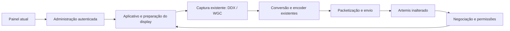
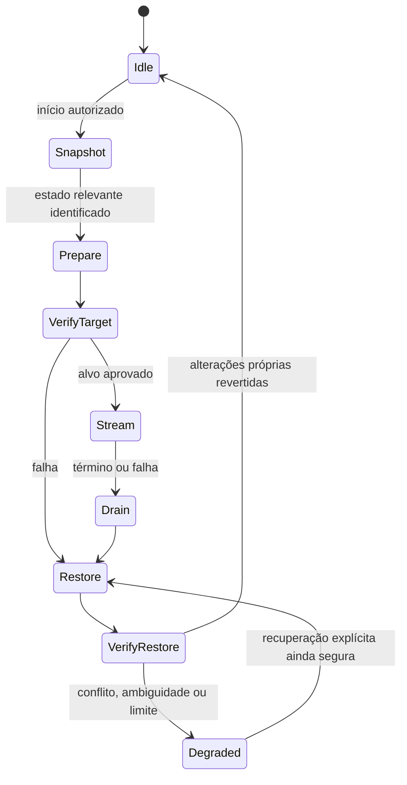

# Arquitetura do host e direção de evolução

Referência de código: [Apollo 1.0.2, `ed3b2395`](https://github.com/matheuspergoli/Apollo/tree/ed3b23951c5e26942ba1675d4993e21ff468f39a).
Este documento distingue implementação existente de propostas. Não descreve novos
modules como se já estivessem entregues. Prioridades e evidências ficam no
[roadmap](roadmap.md); o processo de medição fica em [desenvolvimento](development.md#baseline-e-medição-do-host).

## Decisão de produto

Apollo continua sendo um host de streaming compatível com Artemis, sem cliente ou
protocolo proprietário obrigatório. Windows é o foco ativo desta investigação;
Windows 11 e NVIDIA são um primeiro recorte de medição, não valores fixos no código
nem motivo para quebrar AMD, Intel ou os backends Linux existentes. macOS permanece
fora dos backends mantidos pelo fork.

“Golden” e “GOLDEN 5.0” identificam a visão apresentada no estudo, não uma nova marca,
versão publicada ou autorização para redesenhar o painel. As restrições duráveis
estão na [decisão arquitetural 0001](adr/0001-host-first-and-evidence.md).

## Estado existente

| Responsabilidade | Implementação a consultar | Limite conhecido |
| --- | --- | --- |
| Administração autenticada | `src/confighttp.cpp`, `dashboard/src/lib/`, `dashboard/src/features/` | Gerencia configuração e operações; o painel não mede latência de ponta a ponta |
| Negociação e sessão | `src/nvhttp.cpp`, `src/rtsp.cpp`, `src/stream.cpp` | Preservar permissões, pareamento e contratos do cliente |
| Aplicativo e display da sessão | `src/process.cpp`, `src/display_device.cpp` | Efeitos de display e estado compartilhado precisam ser mapeados antes de reorganizar |
| SudoVDA e topologia Windows | `src/platform/windows/virtual_display.cpp`, `third-party/libdisplaydevice` | Integrações distintas, não um único mecanismo transacional completo |
| Captura | `src/platform/windows/display_base.cpp`, `display_ram.cpp`, `display_vram.cpp`, `display_wgc.cpp` | Aquisição, pacing e cópias variam por backend |
| Conversão e codificação | `src/video.cpp`, `src/nvenc/` | Submissão CPU, espera, trabalho GPU e bitstream não são a mesma duração |
| Packetização e envio | `src/stream.cpp`, envio Windows em `src/platform/windows/misc.cpp` | Entrega local ao sistema operacional não comprova recepção ou apresentação |
| Supervisão do processo | `tools/sunshinesvc.cpp`, reinício em `src/platform/windows/misc.cpp` | Serviço ativo, host HTTP disponível e stream funcional são evidências diferentes |
| Atualização e distribuição | `src_assets/windows/misc/migration/`, `cmake/packaging/`, `tools/release/` | Snapshot de arquivos de instalação não é snapshot do desktop do Windows |

O desenho mostra responsabilidades, não a ordem exata de todas as chamadas. Não
significa que o React coordena a captura ou que cada caixa exige uma classe nova.

### O que não precisa ser implementado outra vez

- `wgc_capture_t::init` já consulta a disponibilidade de `MinUpdateInterval` e
  solicita um intervalo de `10000000 / (framerate * 2)` em unidades de 100 ns.
  Isso solicita atualizações acima de 60 Hz quando a plataforma permite; não
  comprova a frequência entregue pelo compositor ou pelo driver.
- `on_frame_arrived` já fecha e substitui `produced_frame`, sob lock. O frame pool
  tem dois buffers, mas o slot pendente entregue por `next_frame` é latest-wins.
  Não foi identificado um contador de substituições nesse caminho.
- As [correções de relógio](clock-corrections.md) já tratam QPC e TimeSpan do WGC.
  São correções de unidade e precisão, não resultados de benchmark.
- Há estatísticas e logs de pacing, processamento, tamanho codificado, FEC e envio.
  Sua existência não equivale a um tracing completo por sessão e frame.

### WGC e contexto do serviço

O supervisor inicia o host na sessão interativa de console e no desktop
`winsta0\default`, usando `CreateProcessAsUserW`. O WGC possui checagens de runtime;
o caminho não equivale a executar captura na Session 0. Não está demonstrada aqui
cobertura de login, bloqueio, desktop seguro, UAC ou troca de usuário.

Assim, “WGC como serviço” precisa primeiro especificar qual contexto e qual lacuna
do caminho existente serão tratados. Não é justificativa para importar um helper
ou trocar o backend padrão. A seleção automática atual tenta DDX antes de WGC.

## Observabilidade: aproveitar a base sem falsear métricas

| Sinal existente | O que representa | O que não representa |
| --- | --- | --- |
| Timestamp WGC | `SystemRelativeTime`, convertido para a base QPC | Hora do callback ou timestamp de apresentação no cliente |
| Timestamp DDX | Pode considerar `LastPresentTime` e atualização do mouse | A mesma população e origem semântica do WGC |
| `Frame processing latency` | Captura até processamento do pacote, antes de FEC, criptografia e envio | Tempo isolado de NVENC ou latência total do streaming |
| Timer de FEC / envio | Trechos locais de `videoBroadcastThread` | Tempo de trânsito na rede |
| `overall network latency` | Intervalos locais; pode amostrar cumulativamente dentro do loop de blocos FEC | Uma amostra independente por frame ou latência de rede fim a fim |
| `inputTimeStamp` / `outputTimeStamp` NVENC | Índices usados para correlacionar encode | Tempo físico, apesar do nome do campo |
| `img->id` | Identidade de uma imagem alocada e reutilizável | Sequência de cada frame capturado |
| Feedback de perdas / IDR | Informação limitada recebida pelo transporte | Timestamp de decode, apresentação ou scanout |

Consulte `src/logging.h`, `src/stat_trackers.h`, `src/video.cpp` e
`src/stream.cpp`. Os agregadores existentes produzem min/max/média por janela;
não calculam automaticamente p95/p99. Alguns só coletam com determinado nível de
log e emitem ao chegar outra amostra depois do intervalo.

### Candidatos de instrumentação, ainda não implementados

1. Recebidos, substituídos e consumidos na mailbox WGC; chegada até consumo.
2. Aquisição e espera/cópia nos caminhos Windows RAM e VRAM, sem confundir chamada
   CPU com conclusão GPU.
3. Residência entre captura e encode; descarte de pacing, repetição e timestamp ausente.
4. Map/sincronização, submissão, espera/lock e cópia do bitstream no NVENC.
5. Pacote pronto até o último envio local do frame, separando fila, FEC,
   criptografia e pacing; sem contar cada bloco como um frame inteiro.

Primeiro definir a população e os pontos de medição de uma pequena fatia. Só depois
decidir a interface do module. Não acrescentar um coletor genérico a todo o pipeline.

Requisitos para qualquer proposta de telemetria:

- Captura e encoder não aguardam painel, exportação, disco ou agregação.
- Memória, frequência e retenção limitadas; sob pressão, descartar amostras de
  diagnóstico, não bloquear a transmissão. Contabilizar as amostras perdidas.
- Evitar alocação, log por frame e sincronização GPU introduzida apenas para medir.
  Não presumir que uma fila lock-free é necessária antes de mapear os produtores.
- Relógio monotônico, unidades e origem explícitos. Preservar timestamps originais
  quando pacing os ajusta. Não subtrair RTP, índices ou relógios remotos como se
  fossem `steady_clock`.
- Correlação local não altera IDs do protocolo, UUIDs de aplicativos, pareamento
  ou GUIDs persistentes do display. Mapear captura compartilhada e múltiplas sessões.
- Percentis incluem população, janela, quantidade de amostras e ausências. Não
  calcular p99 a partir de médias já agregadas.
- Medir overhead habilitado/desabilitado. Não prometer impacto nulo.

O host observa até a entrega dos dados à interface de envio do sistema operacional.
Sem observação adicional, não sabe quando o cliente exibiu o frame. A exportação
e qualquer futura interface HTTP de diagnóstico continuam propostas, não entregas.

### Privacidade de diagnóstico

A proposta deve usar allowlist de campos: versão, códigos de erro, unidades,
contagens e identificadores efêmeros de correlação. Excluir tokens, credenciais,
chaves, comandos, títulos de janelas, caminhos pessoais, nomes de dispositivos e
endereços desnecessários. Não incluir frames ou áudio por padrão.

Hash de identificador persistente não garante anonimato. Acesso administrativo
autenticado, limites de tamanho/frequência, exportação explícita e revisão de
redação são pré-requisitos de implementação. Pareamento de streaming, sozinho,
não autoriza baixar diagnóstico administrativo. Não exportar a configuração inteira.

## Recuperação e ownership de display

Já existe configuração/reversão via `display_device` e remoção de SudoVDA pelo GUID
em `process.cpp`. Em certos caminhos virtuais, a persistência é resetada. Em
outros, `revert_configuration_unlocked` agenda tentativas sem orçamento global,
com tratamento distinto para indisponibilidade temporária e mudança de dispositivos.
Nem toda iteração reaplica uma configuração. Isso não reproduz automaticamente as
falhas externas citadas no roadmap, mas identifica uma política concreta a revisar.

O objetivo proposto é ownership temporário dos efeitos do Apollo, não posse do
desktop inteiro. Antes de um novo module, mapear quem escreve HDR, topologia,
resolução e frequência nos caminhos atuais e como as chamadas podem se sobrepor.

Este é um modelo proposto de raciocínio, não uma máquina de estados já implementada.
Uma preparação que não alterou nada deve permitir restauração sem efeito.

Invariantes a estudar e proteger antes de automatizar:

- Identidade da tentativa e geração não substituem a identidade persistente do
  monitor. `DISPLAY1` e EDID isoladamente não garantem identificação única.
- Geração local evita comandos antigos do Apollo; não prova autoria de alterações
  externas. Comparar o valor atual com o último aplicado também não basta em todos
  os casos. Quando o ownership for incerto, parar e solicitar recuperação explícita.
- Cleanup repetido é idempotente. Sucesso, cancelamento e falha terminal são distintos.
- Retentativas têm orçamento, prazo e cancelamento. Hotplug não renova esse orçamento
  indefinidamente nem reativa uma tentativa de sessão encerrada.
- Separar desconexão, suspensão, retomada, troca de usuário e reinício do host.
  Não criar processos auxiliares sem necessidade demonstrada e ciclo de término testável.
- Preservar o fail-closed existente: se um display virtual é exigido, falhar não
  autoriza capturar um monitor físico. Qualquer fallback DDX/WGC mantém alvo,
  permissões e restrições da sessão; não contorna desktop seguro.

Não atrasar correções concretas de segurança ou recuperação até existir toda a
telemetria. Tampouco prometer rollback completo de operações do Windows.

## Seams de evolução, não uma reescrita

Control, Session e Media Plane são perspectivas úteis sobre os modules atuais,
não três novas plataformas. Uma interface deve esconder invariantes e produzir
depth, locality e leverage; um adapter só se justifica onde há variação real.
Um module por caixa do desenho, uma flag por correção ou um novo coordenador que
apenas repassa chamadas acrescentariam complexidade sem demonstrar benefício.

Manter o pipeline atual até haver gargalo medido. Telemetria primeiro sem UI;
qualquer painel, perfil ou automação passa por proposta própria e autorização
visual explícita. Experimentos precisam ser reversíveis, mas não se deve tornar
opcional uma correção de integridade ou segurança já estabelecida.
